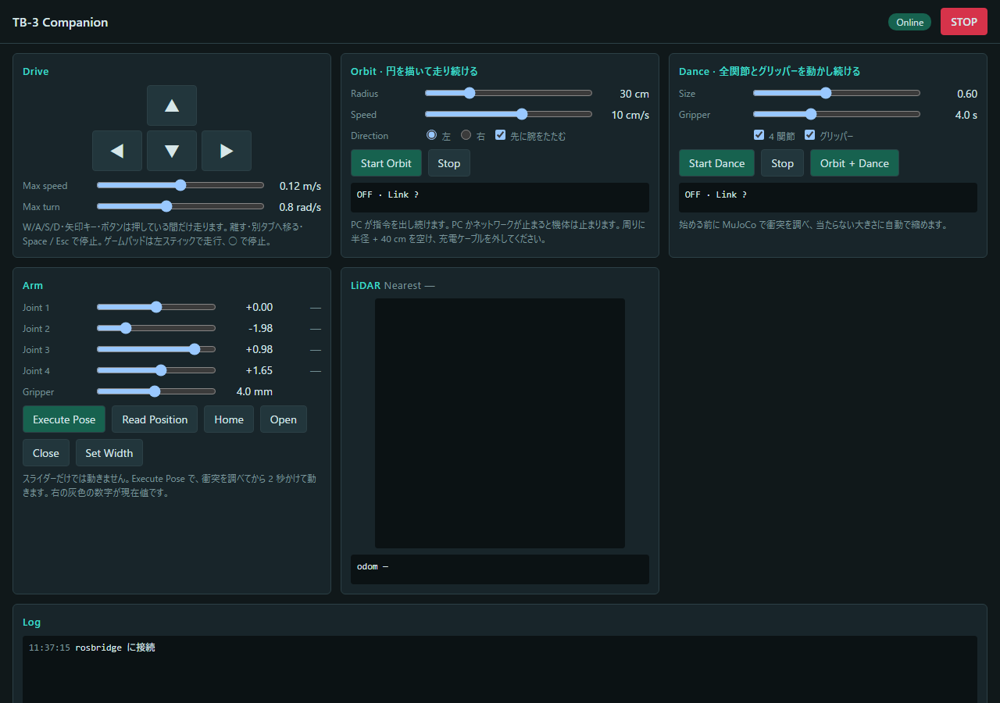

# tb3-companion

TurtleBot3 + OpenManipulator-X を、ブラウザから動かして DDS（ROS 2）の検証をするためのもの。

できること: 走行、アーム・グリッパーの操作、Orbit（円走行）、Dance（全関節を動かし続ける）。PC との通信が切れると機体は止まる。



## 手順

```bash
git clone https://github.com/Saisei2004/turtlebot3-openmanipulator-companion.git tb3-companion && cd tb3-companion
bash pc/scripts/setup_pc.sh          # PC に必要なものを入れる（WSL / Ubuntu の中。1 回だけ）
python3 tb3ctl.py init               # 機体の IP などを答える（鍵の欄は空のまま Enter。鍵は自動で置かれる）
```

1. 機体の電源を入れ、PC とイーサネットケーブルでつなぐ。1〜2 分待って `python3 tb3ctl.py status`（「ssh できる」と出ればよい）
2. `python3 tb3ctl.py robot-wifi --ssid <SSID> --psk <パスフレーズ> --set-host`（PC も同じ Wi-Fi につないでおく）
3. ケーブルを外す
4. `python3 tb3ctl.py server --open`（ブラウザが開く）

Windows は、先に [docs/01](docs/01-quickstart-new-pc.md) の「Windows の準備」（WSL2 とファイアウォール）を済ませる。Windows の `cmd` では `tb3ctl.cmd`、Linux では `./tb3ctl` でも同じ。
機体が新品の SD のときだけ、手順 1 のあとに `python3 tb3ctl.py robot-install`（[docs/02](docs/02-robot-provisioning.md)）。
手順 1 の直結と、手順 2 の Wi-Fi 設定は、まだ実機では動かしていない（[確認状況](docs/10-handoff-checklist.md)）。

困ったとき・詳しいこと: [docs/](docs/00-overview.md)（[引き継ぎ](docs/10-handoff-checklist.md)、[DDS の検証](docs/04-dds-verification-guide.md)、[安全](docs/06-safety.md)、[トラブル](docs/08-troubleshooting.md)）

**わからないことは、松田に Slack で聞いてください。または、このリポジトリで [Issue](https://github.com/Saisei2004/turtlebot3-openmanipulator-companion/issues/new) を立ててください。**

## ライセンス

このリポジトリの自分たちのコードの**ライセンスは未設定**（持ち主が決める）。第三者のもの（ROBOTIS のメッシュ・URDF・パッチの元、MuJoCo など）は [NOTICE.md](NOTICE.md)。
