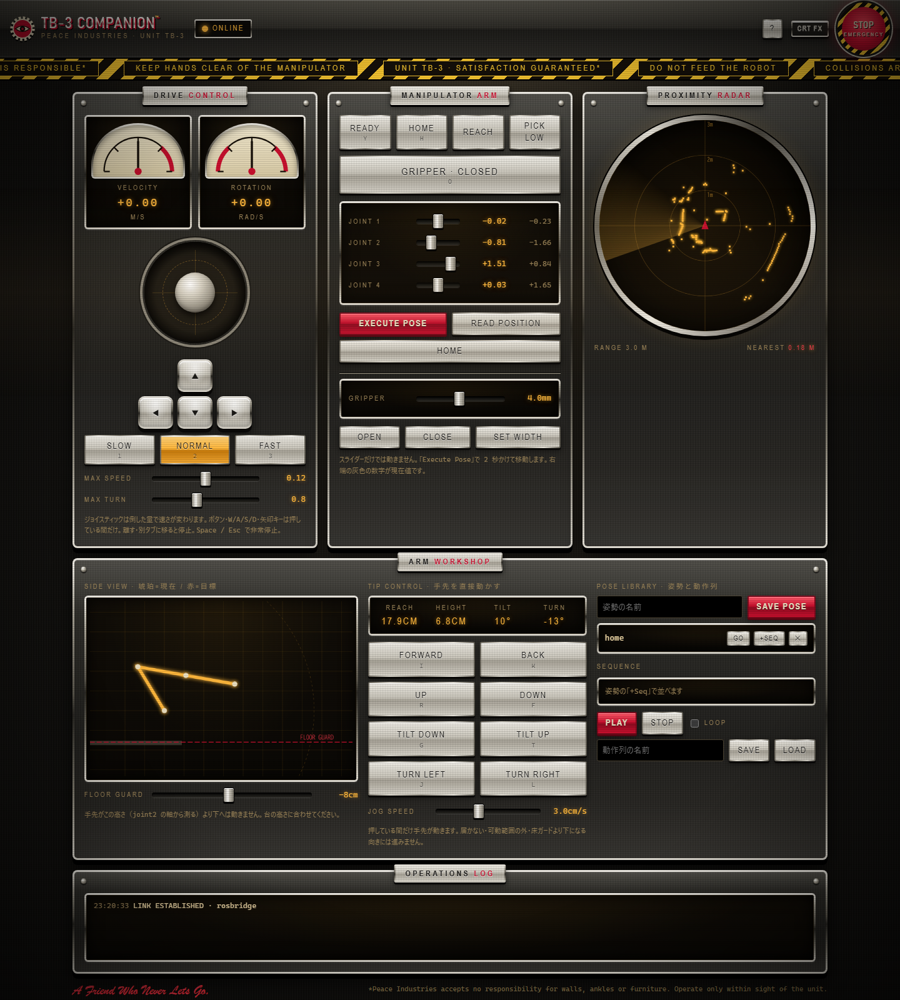

# tb3-companion

TurtleBot3（Waffle サイズに作り変えた 2 段の車体）+ OpenManipulator-X（以下 **TB-3**）を、ブラウザの操作画面から動かし、DDS（ROS 2）の検証を進めるための、ソースコードと知識のまとめ。PC が止まったら機体も止まる仕組みと、無線（Wi-Fi）だけで動く構成を含む。

- 機体: Raspberry Pi 4（4 GB）/ Ubuntu 22.04.5 / ROS 2 Humble / OpenCR / LiDAR LDS-02
- PC: Windows（WSL2）または Ubuntu 22.04。ブラウザで `http://localhost:8080/`

## できること

| 機能 | 内容 |
|---|---|
| 走行 | ジョイスティック（倒した量で速さが変わる）、WASD・矢印キー、速度の 3 段（SLOW / NORMAL / FAST） |
| アーム・グリッパー | 関節ごとのスライダー、手先の直接操作（前後・上下・傾き・旋回）、READY / HOME / REACH / PICK LOW、側面図のタップ移動、姿勢の保存と連続再生 |
| Orbit | 半径 20〜60 cm（既定 30 cm）の円を走り続ける。LiDAR で進路を見て、障害物があれば止まる |
| Dance | 4 つの関節がずっと動き続ける周期 24 秒の動きと、グリッパーの開閉。始める前に MuJoCo で衝突を調べ、当たらない大きさに縮める |
| MuJoCo の衝突判定 | アームを動かす前に、経路を MuJoCo で調べ、当たる動きは断る |
| 止まる仕組み | PC が 20 Hz で心拍を出し、機体側の見張り（deadman）が 0.3 秒途切れたら腕と車輪を止める |
| 無線 | 機体は Wi-Fi だけで動く。有線を抜き差ししても ROS 2 の通信が壊れない設定 |

操作画面（PC 幅）:



## 構成

```
 ブラウザ ── http :8080 ──┐
          ── ws   :9090 ──┤            PC（WSL2 の Ubuntu / Ubuntu）
                          ▼
              ┌─ tb3_server.py ── 画面の配信、/api/*、MuJoCo の衝突判定
              ├─ circle_driver.py ── Orbit / Dance / グリッパーのドライバ（ROS 2 ノード、心拍 20 Hz）
              └─ rosbridge_server ── ブラウザ ⇔ ROS 2
                          │
                          │  ROS 2 / DDS（Fast DDS、UDP）  ← Wi-Fi（有線でも可）
                          ▼
              機体（Raspberry Pi 4）
              ├─ tb3-bringup   ros2_control（OpenCR 経由で車輪・腕・グリッパー）+ LiDAR ドライバ
              ├─ tb3-deadman   心拍が途切れたら腕と車輪を止める
              ├─ tb3-watchdog  モーターとの通信が切れたら tb3-bringup を起動し直す
              └─ wifi-powersave-off
                          │ USB
                          ▼
                    OpenCR ── Dynamixel（車輪 2、アーム 4 関節 + グリッパー）
```

詳しくは [docs/00-overview.md](docs/00-overview.md)。

## 3 ステップのクイックスタート（別の PC で）

機体がすでに動いている（機体側の導入が済んでいる）場合。Windows は先に [docs/01-quickstart-new-pc.md](docs/01-quickstart-new-pc.md) の「Windows」（WSL2 の mirrored ネットワークとファイアウォール）を済ませる。

1. PC に ROS 2 Humble・rosbridge・MuJoCo を入れる（Ubuntu 22.04 / WSL2 の Ubuntu の中で）

   ```bash
   bash pc/scripts/setup_pc.sh
   ```

2. 設定ファイル `config/tb3.env` を作る（機体の IP、ROS_DOMAIN_ID など）

   ```bash
   python3 tb3ctl.py init
   ```

3. サーバーを起動して、ブラウザで `http://localhost:8080/` を開く

   ```bash
   python3 tb3ctl.py server
   ```

機体が新品（まっさらな Ubuntu 22.04）のときは、2 のあとに `python3 tb3ctl.py robot-install`（[docs/02-robot-provisioning.md](docs/02-robot-provisioning.md)）。初めて機体を動かす前に、必ず [docs/06-safety.md](docs/06-safety.md) の手順を読む。

Windows の `cmd` では `tb3ctl.cmd`、Linux では `./tb3ctl` でも同じ。

## 確かめたこと／未検証

| 項目 | 状態 |
|---|---|
| 機体での ROS 2 Humble + manipulation の導入・起動、OpenCR へのファームウェア書き込み | **実機で確認**（2026-10-25〜26、コマンドを 1 つずつ） |
| 通信を減らした制御プラグイン（パッチ）で腕の指令が約 20 Hz になる | **実機で測定**（[docs/07](docs/07-findings-and-gotchas.md)） |
| 操作画面から走行・アーム・グリッパー、手先の直接操作、READY | **実機で確認** |
| HOME（折りたたみ姿勢） | 本人が 1 回押して確認（目視。数値の記録なし） |
| Dance（大きさ 0.6、数回） | **実機で確認**（0.9 は試験用の設定でしか動かしていない） |
| PC が落ちたとき腕が止まる（`kill -9`） | **実機で測定**（有線のとき、指令が約 0.58 秒で止まった） |
| 機体を Wi-Fi だけで使う（有線を切った状態を再現） | **実機で測定**（心拍の間隔、腕の追従）。**実際にケーブルを抜いての電源の入れ直しは未検証**（ケーブルをつけたままの再起動と、有線を `ip link set eth0 down` で切った状態は確認済み） |
| Orbit（円走行）の実機での走行 | **未検証**（指令の値と頻度・障害物判定の計算、通信が切れたときの停止は、機体に送らない試験用の設定で確認） |
| ゲームパッド操作 | **未検証**（PC にゲームパッドがなかった） |
| `robot/install_robot.sh` をまっさらな SD から最後まで通す | **未検証**（同じコマンドを 1 つずつ実機で動かしただけ） |
| `tb3ctl robot-install` / `robot-apply` / `robot-wifi` | **未検証**（`--dry-run` で組み立てるコマンドを見ただけ） |
| `tb3ctl server` / `stop` / `status` / `ros`（PC 側） | WSL で動かして確認 |
| `tests/run_tests.sh`（機体なし） | WSL で全部通る（`ALL OK`） |
| パッチが公式 `ROBOTIS-GIT/turtlebot3_manipulation` の `814f140` に当たる | 確認（`git apply --check`） |
| Docker（`pc/docker/`） | **未ビルド** |
| MuJoCo の解析結果の、実物との一致 | 車体の寸法は写真からの推測を含む（[docs/05](docs/05-arm-kinematics-and-mujoco.md)）。実機で衝突の境界を試してはいない |

## リポジトリの地図

| 場所 | 内容 |
|---|---|
| `tb3ctl.py`（`tb3ctl` / `tb3ctl.cmd`） | 操作コマンド（`init` `robot-install` `robot-apply` `robot-wifi` `robot-ssh` `server` `stop` `status` `ros`） |
| `config/` | `tb3.env.example`（設定の例）。`tb3.env` は個人の設定（git に入れない） |
| `robot/` | 機体側。`install_robot.sh`、`bin/`（サービスが使うスクリプト）、`systemd/`、`udev/`、`hardware_patch/`（公式の制御プラグインに当てるパッチ） |
| `pc/server/` | PC 側のサーバー。`tb3_server.py`、`circle_driver.py`、`webui/`（操作画面）、`workspace/`（MuJoCo のモデルと解析結果） |
| `pc/scripts/` | PC 側の起動・停止・導入のスクリプト。`windows/` に Windows 用 |
| `pc/docker/` | Docker（未ビルド） |
| `dds/` | DDS 検証キット（プロファイルのひな形、測定ツール） |
| `tools/` | 機体の上や PC から使う、調査・測定の道具（OpenCR の通信の測定、記録など） |
| `tests/` | 機体なしで動かせる確認。`bash tests/run_tests.sh` |
| `docs/` | ドキュメント（下） |

## ドキュメント

| ファイル | 内容 |
|---|---|
| [docs/00-overview.md](docs/00-overview.md) | システムの全体像、トピック・API・ポート・ファイルの場所 |
| [docs/01-quickstart-new-pc.md](docs/01-quickstart-new-pc.md) | 別の PC・別のネットワークで動かす手順 |
| [docs/02-robot-provisioning.md](docs/02-robot-provisioning.md) | 機体をまっさらな SD から作る。この機体の今の状態、バックアップ |
| [docs/03-network-and-dds.md](docs/03-network-and-dds.md) | ネットワークと DDS の設定の知識 |
| [docs/04-dds-verification-guide.md](docs/04-dds-verification-guide.md) | DDS の検証ガイド（実験の一覧、測定ツール） |
| [docs/05-arm-kinematics-and-mujoco.md](docs/05-arm-kinematics-and-mujoco.md) | アームの座標・関節の 0 位置のずれ・MuJoCo の解析 |
| [docs/06-safety.md](docs/06-safety.md) | 安全の仕組みと限界、初めて動かす手順 |
| [docs/07-findings-and-gotchas.md](docs/07-findings-and-gotchas.md) | 分かったことと落とし穴 |
| [docs/08-troubleshooting.md](docs/08-troubleshooting.md) | 症状から引く対処 |
| [docs/09-history-and-decisions.md](docs/09-history-and-decisions.md) | 経緯と、決めたこと・理由 |
| [docs/10-handoff-checklist.md](docs/10-handoff-checklist.md) | 引き継ぎのチェックリスト（**最初に読む**） |
| [docs/NETWORK-first-setup.md](docs/NETWORK-first-setup.md) | 最初に無線化したときの記録（当時の名前・パスで書かれている。履歴） |

## ライセンス

このリポジトリの自分たちのコードの**ライセンスは未設定**（公開する前に、持ち主に確認が要る）。第三者のもの（ROBOTIS のメッシュ・URDF・パッチの元、MuJoCo など）は [NOTICE.md](NOTICE.md)。
